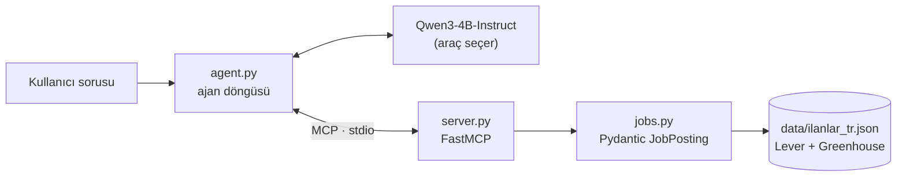

# İş Fırsatı Ajanı · MCP Sunucusu + Qwen3 Araç Çağırma

[](https://github.com/alimdemir/job-opportunity-mcp-agent/actions/workflows/ci.yml)
[](https://colab.research.google.com/github/alimdemir/job-opportunity-mcp-agent/blob/main/notebooks/03_mcp_ajan_qwen_colab.ipynb)


Türk teknoloji şirketlerinin (Trendyol, Insider One, Midas, Dream Games) kariyer sayfalarındaki ilanları ortak bir şablona dönüştüren, bunları [Model Context Protocol](https://modelcontextprotocol.io) araçları olarak sunan ve bir dil modelinin bu araçları kendi seçerek kullandığı küçük bir iş fırsatı ajanı. AVD Teknoloji Danışmanlık'taki stajımın (2026) ikinci haftasında geliştirdim.

## Nasıl çalışıyor



1. **Veri** (`scripts/`): `ilanlari_cek.sh` dört şirketin ilanlarını işe alım sistemlerinin herkese açık ilan uçlarından indirir (giriş ya da sayfa kazıma yok, şirket başına tek istek). `veri_seti_olustur.py` bunlardan 14 ilanlık veri setini oluşturur; HTML düz metne çevrilir, tarih ve başvuru adresi alınmaz, e-posta ve telefon numaraları silinir.
2. **Standartlaştırma** (`jobs.py`): Lever ve Greenhouse aynı bilgiyi farklı alanlarda veriyor (Lever'da `categories.commitment` ve `workplaceType`, Greenhouse'ta çalışma biçimi alanı hiç yok). İkisi de `JobPosting` şablonuna dönüştürülür: şirket, rol, konum, ülke, çalışma biçimi, çalışma türü, ücret, teknolojiler, istenen diller, vatandaşlık şartı, kaynak. **İlanda açıkça yazmayan bilgi tahmin edilmez, `None` kalır.**
3. **MCP sunucusu** (`server.py`):
   - `search_postings(keyword, remote_only=False, limit=5)`: başlık ve açıklamada anahtar kelime arar
   - `get_posting(posting_id)`: tek ilanı şablonda döndürür, ilan yoksa `ToolError` verir (boş sonuç "uygun ilan yok" diye yorumlanmasın diye)
   - `check_fit(posting_id, skills, country, languages, wants_remote)`: kural tabanlı ön kontrol. İlanın ülkesini, vatandaşlık şartını (`Saudi Nationals Only` gibi), istenen dilleri, çalışma biçimini ve ilanda açıkça geçen becerilerle eşleşmeyi `FitReport` olarak döndürür
   - `tr-jobs://sources` kaynağı: kullanılan ilan uçları
   - Loglar stdout'a değil stderr'e yazılır, çünkü stdio taşımasında stdout protokole ayrılmış.
4. **Ajan döngüsü** (`agent.py`): MCP araç listesi modele fonksiyon tanımı olarak verilir. Model `<tool_call>` ürettikçe araç çağrılır ve sonuç `role=tool` mesajıyla geri beslenir. Aynı çağrı tekrarlanırsa sunucuya gitmez; en fazla `max_steps` adım çalışır.

## Kurulum

```bash
python -m venv .venv && source .venv/bin/activate
pip install -r requirements-dev.txt
pytest -v                                   # 20 test
```

Veriyi yeniden oluşturmak için (ilanlar kapanmış olabilir; seçim listesi `scripts/veri_seti_olustur.py` içinde):

```bash
bash scripts/ilanlari_cek.sh && python scripts/veri_seti_olustur.py
```

### MCP Inspector ile deneme

```bash
npx @modelcontextprotocol/inspector python server.py
```

### Claude Desktop / VS Code'a ekleme

```json
{
  "mcpServers": {
    "tr-jobs": { "command": "/tam/yol/.venv/bin/python", "args": ["/tam/yol/server.py"] }
  }
}
```

## Not defterleri

| Not defteri | Ortam | İçerik |
|---|---|---|
| [`01_ilan_standartlastirma`](notebooks/01_ilan_standartlastirma.ipynb) | CPU | İki sistemin alan farkı, 14 ilanın şablona dönüşümü, boş bırakılan alanlar, ilan metninden çıkarılan şartlar |
| [`02_profil_eslestirme`](notebooks/02_profil_eslestirme.ipynb) | CPU | Örnek profil ile ön kontrol: eşleşen beceri, yalnızca öğrenme hedefi, dil / vatandaşlık / ülke şartları |
| [`03_mcp_ajan_qwen_colab`](notebooks/03_mcp_ajan_qwen_colab.ipynb) | Colab A100 | MCP istemcisi + Qwen3-4B-Instruct-2507: yalnız arama araçlarıyla ve `check_fit` ile iki sürümün karşılaştırması, hata senaryosu |

## Öğrendiklerim / tasarım kararları

- **Eksik bilgi ≠ olumsuz bilgi.** Ücretin yazmaması düşük olduğu anlamına gelmez. 14 ilanın hiçbirinde ücret yok; Greenhouse ilanında çalışma biçimi ve türü de belirtilmemiş. Bu alanlar boş bırakıldı.
- **Teknik uyum, başvurulabilirlik demek değil.** Örnek profille en çok örtüşen ilan (Trendyol, Data Scientist) açıklamasında ileri düzey Arapça istiyor; Riyad'daki ilan yalnızca Suudi vatandaşlarına açık. Bu şartları modelin yorumuna bırakmak yerine `check_fit` aracını ekledim; sistem istemi öneriden önce bu aracın çağrılmasını istiyor.
- **Kısa adlar dikkat ister.** "Go" ya da "REST" büyük/küçük harf duyarsız aranınca sıradan İngilizce kelimelerle eşleşiyor; kısaltmalar harf duyarlı aranıyor.
- **Öğrenme hedefi deneyim sayılmaz.** Profildeki "öğrenmek istediği" teknolojiler eşleşen beceri olarak sayılmıyor.
- **Araç açıklaması, modelin arayüzü.** FastMCP şemayı docstring ve tür ipuçlarından üretiyor; parametre adları ve açıklamalar Inspector'da modelin gördüğü biçimde kontrol edildi.

## Veri

`data/ilanlar_tr.json`: Trendyol, Insider One ve Midas'ın [Lever](https://github.com/lever/postings-api), Dream Games'in [Greenhouse](https://developers.greenhouse.io/job-board.html) ilan uçlarından alınan 14 ilan (teknik roller ve ön kontrolü sınamak için yurt dışı ya da şartlı birkaç ilan). İlanlar şirketlerin kendi yayınladığı herkese açık metinlerdir; her kayıtta özgün ilanın bağlantısı vardır.

## Lisans

[MIT](LICENSE)
